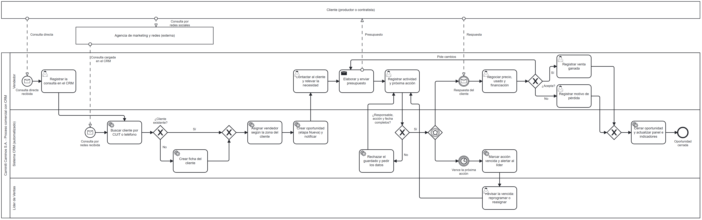

# Proceso comercial con CRM (BPMN 2.0)

Modelo del proceso organizativo que el CRM transforma: la gestión de una consulta comercial desde que ingresa hasta que la oportunidad se cierra como ganada o perdida.

- Archivo fuente editable: [`bpmn/proceso-comercial-crm.bpmn`](bpmn/proceso-comercial-crm.bpmn) (BPMN 2.0; se abre en [bpmn.io](https://demo.bpmn.io) o Camunda Modeler).
- Versión vectorial: [`bpmn/proceso-comercial-crm.svg`](bpmn/proceso-comercial-crm.svg).

## Cómo leer la notación

| Elemento | Significado |
|----------|-------------|
| Tarea con ícono de persona | Tarea de usuario: la realiza una persona usando el CRM. |
| Tarea con ícono de engranaje | Tarea de servicio: la ejecuta el CRM de forma automática. |
| Tarea con ícono de sobre | Tarea de envío: emite un mensaje hacia otro participante. |
| Círculo con sobre | Evento de mensaje: el proceso se inicia o se detiene a esperar un mensaje externo. |
| Círculo con reloj | Evento de temporizador: se activa cuando vence un plazo. |
| Rombo con X | Compuerta exclusiva: se toma un solo camino según una condición. |
| Rombo con pentágono | Compuerta basada en eventos: continúa por el primer evento que ocurra. |
| Línea continua con flecha | Flujo de secuencia dentro de la organización. |
| Línea punteada | Flujo de mensaje entre participantes distintos. |

## Participantes (pools)

| Pool | Tipo | Rol en el proceso |
|------|------|-------------------|
| Cliente (productor o contratista) | Externo, caja negra | Origina la consulta, recibe el presupuesto y responde. |
| Agencia de marketing y redes | Externo, caja negra | Atiende las redes sociales y carga en el CRM las consultas que recibe. |
| Caminiti Caminos S.A. | Interno | Ejecuta el proceso comercial con apoyo del CRM. |

## Roles internos (lanes)

| Lane | Responsabilidad |
|------|-----------------|
| Vendedor | Registra consultas directas, contacta, presupuesta, negocia y registra el resultado. Incluye al líder y al gerente comercial cuando atienden clientes. |
| Sistema CRM (automatizado) | Busca o crea el cliente, asigna el vendedor por zona, crea la oportunidad, valida los datos de seguimiento, controla vencimientos y actualiza indicadores. |
| Líder de Ventas | Revisa las acciones vencidas y decide si se reprograman o se reasignan. |

## Flujo estándar

1. La consulta ingresa por dos vías: **directa** (teléfono o visita al vendedor, que la registra en el CRM) o **por redes** (la agencia la carga en el CRM).
2. El CRM busca al cliente por CUIT o teléfono; si no existe, crea su ficha.
3. El CRM asigna el vendedor según la zona del cliente y crea la oportunidad en etapa *Nueva*.
4. El vendedor contacta al cliente, releva la necesidad y envía el presupuesto.
5. El vendedor registra la actividad y la próxima acción con fecha.
6. El cliente responde; el vendedor negocia precio, usado y financiación.
7. Si el cliente acepta, se registra la venta ganada; el CRM cierra la oportunidad y actualiza el panel.

## Compuertas y excepciones

| Compuerta | Tipo | Excepción que controla |
|-----------|------|------------------------|
| ¿Cliente existente? | Exclusiva | Evita fichas duplicadas: solo crea un cliente cuando no existe. |
| ¿Responsable, acción y fecha completos? | Exclusiva | Regla de oro del seguimiento (meta M3): el CRM rechaza guardar una oportunidad abierta sin esos datos. |
| Espera de respuesta | Basada en eventos | Lo que ocurra primero: la respuesta del cliente o el vencimiento de la próxima acción. Si vence, el CRM alerta al líder, que reprograma o reasigna. |
| ¿Acepta? | Exclusiva | Tres salidas: acepta (ganada), rechaza (se registra el motivo de pérdida) o pide cambios (vuelve a presupuestar). |

## Qué transforma el CRM

| Antes (relevamiento, Entrega 1) | Con el proceso modelado |
|---------------------------------|-------------------------|
| Las consultas de redes quedan en quien atiende el canal. | Toda consulta entra al CRM y se asigna por zona. |
| No hay mecanismo de seguimiento si la venta no cierra en el momento. | Ninguna oportunidad abierta queda sin próxima acción; el vencimiento dispara una alerta. |
| El historial queda en la memoria o el teléfono de cada vendedor. | Cada contacto queda registrado como actividad del cliente. |
| No se sabe por qué se pierden ventas. | El motivo de pérdida es obligatorio. |

## Relación con el resto del proyecto

- **Organigrama (Entrega 3):** las lanes corresponden al Área de Ventas y su líder intermedio; la agencia es uno de los asesores externos de staff.
- **Diccionario de datos (Entrega 3):** las tareas crean y actualizan las entidades Cliente, Oportunidad y Actividad.
- **Historias de usuario:** ver [02-historias-de-usuario.md](02-historias-de-usuario.md).
- **Indicadores de control:** ver [03-indicadores-de-control.md](03-indicadores-de-control.md).
